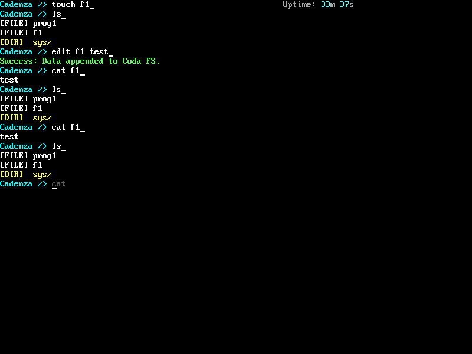

# 🎹 CadenzaOS

> *An operating system that learns how you work — and uses that knowledge to protect you.*

CadenzaOS is a 64-bit operating system built from scratch in Zig 0.16.0, for bare-metal x86-64 hardware. It is not a Unix clone or a teaching exercise in the traditional sense: CadenzaOS is an exploration of what an OS looks like when behavioural intelligence is a first-class kernel concern rather than a bolt-on application layer.

The kernel observes, models, and acts on user and program behaviour in real time — flagging anomalies, adapting security policy, and learning what "normal" looks like for your specific deployment. The goal is an OS where the kernel itself is the first line of defence, not a passive substrate waiting to be told what to do.

📍 Status and limitations

CadenzaOS is an early research project. Please read this before you try it.

QEMU: boots to the shell. Every push is built from a clean checkout and booted headless in QEMU by CI, which checks that the shell prompt appears.
Real hardware: it boots on a Dell OptiPlex 3020 (legacy BIOS) but does not yet reach the shell. Text rendering and panic output on that machine are garbled, and we have not yet pinned down whether the cause is the rendering path or the data reaching it. Serial output hardware for debugging is on order. Until this is resolved, treat QEMU as the supported way to run CadenzaOS. <!-- TODO: confirm this still matches the current state of the OptiPlex -->
No memory protection: programs run in ring 0 in the kernel's address space. The behavioural-security features observe and flag, but they cannot yet contain a misbehaving program, and a buggy or hostile program can overwrite kernel memory. Privilege separation is Phase 8. <!-- TODO: check "observe and flag" matches what the Conductor and Composer actually do -->
Small syscall surface: there is no keyboard-input syscall yet, so programs can print but not read.
✨ What makes CadenzaOS different

Most operating systems treat security as something you add on top: antivirus software, firewalls, sandboxes. CadenzaOS aims to treat it as something built in from the ground up:

The Conductor — a kernel-level state machine that monitors command velocity, I/O latency, and system rhythm, shifting between Optimal, Discordant, and Critical states in real time.
The Composer — a Markov chain engine that learns your command sequences and uses that model to detect anomalous behaviour. If a sequence of commands looks statistically unusual for this user on this system, the kernel notices — before any damage is done.
Modern APIC Architecture — symmetric multiprocessor-ready interrupt processing using a modern Local APIC (LAPIC) and I/O APIC pipeline with runtime feature flag fallbacks to legacy 8259 PIC.
Policy-aware superblock — the filesystem itself carries a policy mode (ADMIN, DEV, GAMING) that governs how aggressively the Conductor responds to anomalies. Hardware-level policy, not application-level configuration.
Behavioural syscall tracking — the kernel's syscall gateway is the natural point to extend this model from user commands to program behaviour: which syscalls does a program normally make, in what sequence, with what frequency?

This positions CadenzaOS as a research platform and proof of concept for adaptive security at the kernel level — particularly relevant for constrained-use deployments (kiosk systems, industrial terminals, secure workstations) where the set of normal operations is well-defined and deviations are meaningful signals.

See PRINCIPLES.md for the values the project is built on. <!-- TODO: confirm PRINCIPLES.md is in the repo -->

🚀 Current capabilities

The following work today in QEMU:

Boot, APIC & hardware
Custom two-stage bootloader (boot.asm → stage2.asm) with E820 memory mapping
Long mode transition with identity-mapped + higher-half page tables
Modern Local APIC (LAPIC) and I/O APIC interrupt pipeline with 8259 PIC runtime fallback option
Dedicated interrupt stack (TSS / IST) for timer, keyboard and mouse interrupts
ATA PIO disk driver (read/write, LBA28)
PS/2 Keyboard and PS/2 Mouse packet drivers with scan code translation and packet parsing
VGA text mode driver (80×25) and VESA framebuffer driver (800×600×24bpp)
Serial port output (COM1, 38400 baud) mirrored alongside VGA/framebuffer
Physical frame allocator (frame_allocator.zig) and page manager (page_allocator.zig) with explicit reserved ranges for all kernel structures
Filesystem — CodaFS
Custom extent-based filesystem with persistent superblock, space manager, and directory tree
Survives reboots — write-through to ATA via RAM disk backing
Full directory support: nested directories, extent-based file growth
Commands: ls, cd, mkdir, touch, edit, cat, stat, del, mv, rename, df
Shell & terminal
Predictive ghost-text completion via Markov chain (composer.dat persisted in sys/)
Command history navigation
Velocity entropy monitoring — high-speed command input triggers policy-based responses
Anomaly detection — statistically unusual command sequences prompt confirmation
Real-time uptime display (MM:SS) and disk usage reporting via kernel vitals monitor
Multitasking & programs
Preemptive multitasking via APIC / IRQ0 timer with full InterruptContext save/restore
Dynamic task spawning (spawn <program> [args...]) and clean task exit, with the task's memory and scheduler slot reclaimed on exit
External programs: flat binaries built separately, stored in CodaFS, and loaded as tasks at runtime. Each begins with a 16-byte header (magic, version, entry offset, image size) that the kernel validates before running anything
Command-line arguments: up to 8 arguments / 512 bytes, passed as argc in rdi and argv in rsi
Syscall interface (int $0x80, number in rax):
0: EXIT
1: PRINT_STRING (pointer + length + colour)
2: GET_SCRATCH_BYTE (persistent cross-spawn scratch page)
3: SET_SCRATCH_BYTE
4: PRINT_CHAR
5: INCREMENT_SCRATCH_BYTE (atomic read-modify-write)
🛠 Building
Requirements

See DEPENDENCIES.md for the full list, install commands and tested versions. In short:

Tool	Version	Notes
Zig	0.16.0 exactly	Other versions will not compile
NASM	tested with 2.x and 3.02	Bootloader and IRQ assembly stubs
GNU binutils (as, ld, objcopy, readelf)	tested with 2.42 and 2.46	Kernel linking
QEMU	tested with 10.2.2	qemu-system-x86_64
<!-- TODO: confirm the NASM / binutils versions against the CI log and DEPENDENCIES.md -->

Zig 0.16.0 can be downloaded from ziglang.org/download. Put it on your PATH, or point the build at it with export ZIG=/path/to/zig.

Build and run
bash
git clone https://github.com/GlenMeehan/CadenzaOS.git
cd CadenzaOS
./build.sh

./build.sh assembles the bootloader, compiles the kernel and the prog1 demo program, links everything, creates a 10MB disk image, and launches QEMU. You should see the splash screen followed by a Cadenza /> prompt.

bash
# Run without rebuilding (preserves filesystem state)
./build.sh run

# Wipe the disk image and start fresh
./build.sh clean && ./build.sh

# Non-interactive build, no QEMU (used by CI and the smoke test)
./build.sh ci

When an existing disk image is found, ./build.sh asks whether to preserve the filesystem. Answer n after changing a program, because CodaFS keeps its old copy otherwise.

Smoke test
bash
./build.sh ci && ./tests/smoke.sh

Boots the image headless in QEMU and passes if the shell prompt appears on the serial port.

Monitor serial output

Serial output (all kernel and shell text) is mirrored to serial.log:

bash
tail -f serial.log
Programs

Programs live in userland/. ./build.sh builds the prog1 demo from userland/prog1/ and stages it on the disk image, and the kernel installs it into CodaFS on the first boot of a fresh image. Run it from the shell:

spawn prog1 hello world

For the program format (header layout, entry point, argument convention) see src/kernel/binfmt.zig.

🏗 Project structure
CadenzaOS/
├── src/
│   ├── boot/
│   │   └── boot.asm              # Stage 1 — MBR bootloader
│   ├── stage2/
│   │   └── stage2.asm            # Stage 2 — long mode transition, VESA mode init
│   └── kernel/
│       ├── kernel.zig            # kmain — boot sequence and hardware init
│       ├── config.zig            # Version, disk layout, system policy
│       ├── apic.zig              # Local APIC & I/O APIC setup & redirection table
│       ├── pic.zig               # Legacy 8259 PIC controller fallback
│       ├── idt.zig               # Interrupt Descriptor Table (IDT) configuration
│       ├── tss.zig               # Task State Segment and IST interrupt stack
│       ├── irupts.zig            # High-level IRQ interrupt handlers
│       ├── scheduler.zig         # Preemptive task scheduler + syscall dispatch
│       ├── binfmt.zig            # Program header format and validation
│       ├── shell.zig             # Interactive shell and command dispatch
│       ├── terminal.zig          # Line editor with ghost-text prediction
│       ├── conductor.zig         # Behavioural state machine
│       ├── security.zig          # Anomaly detection & velocity monitoring
│       ├── memory.zig            # Address translation (physToVirt/virtToPhys)
│       ├── page_allocator.zig    # Virtual page management
│       ├── frame_allocator.zig   # Physical frame allocator (bitmap)
│       ├── E820.zig              # BIOS memory map parsing
│       ├── boot_info.zig         # BootInfo structure (passed from stage2)
│       ├── framebuffer.zig       # VESA framebuffer renderer
│       ├── vga.zig               # VGA text mode driver
│       ├── console.zig           # Unified console output interface
│       ├── vitals.zig            # Kernel uptime & telemetry system
│       ├── inputs/
│       │   ├── keyboard.zig      # PS/2 keyboard event processing
│       │   └── key_event.zig     # Key code abstraction & ring buffer
│       ├── drivers/
│       │   ├── ata.zig           # ATA PIO disk driver
│       │   ├── mouse.zig         # PS/2 mouse driver & packet processing
│       │   └── serial.zig        # COM1 serial output
│       ├── interrupts/
│       │   └── irq_stubs.asm     # Assembly ISR / IRQ entry points
│       ├── ui/
│       │   └── prompt.zig        # Shell prompt renderer
│       └── fs/
│           ├── coda_fs.zig       # CodaFS filesystem implementation
│           ├── coda_file.zig     # File and directory entry types
│           ├── coda_sm.zig       # Space manager (extent allocator)
│           ├── ata_block_device.zig # ATA block storage layer
│           ├── block_device.zig  # Block device abstraction
│           ├── binary_loader.zig # Installs the staged program into CodaFS
│           └── ramdisk.zig       # RAM disk (write-through to ATA)
├── userland/
│   └── prog1/                    # Demo program (source + linker script)
├── tests/
│   └── smoke.sh                  # Headless QEMU boot test
├── .github/workflows/smoke.yml   # CI: build + boot test on every push
├── linker.ld                     # Kernel linker script
├── build.sh                      # Build and run script
├── DEPENDENCIES.md
├── ROADMAP.md
├── PRINCIPLES.md
├── GOVERNANCE.md
├── CONTRIBUTING.md
└── CODE_OF_CONDUCT.md
<!-- TODO: check this tree against `git ls-files` for anything missing -->
🗺 Roadmap

Detailed OS-level planning lives in ROADMAP.md. The phases below are the overview.

✅ Phase 1 — Foundation
Custom BIOS bootloader (two-stage, E820, long mode)
Physical frame allocator and page management
ATA PIO disk driver and serial debugging setup
✅ Phase 2 — Filesystem
CodaFS custom filesystem with extents and persistence
Write-through RAM disk backing to ATA
Full directory tree and file operations
✅ Phase 3 — Shell & Intelligence
Interactive shell with command history
The Conductor — behavioural state machine with policy modes
The Composer — Markov chain prediction with ghost-text completion
Velocity entropy monitoring and anomaly detection
✅ Phase 4 — Multitasking & Binaries
Preemptive multitasking via IRQ timer with context switching
External program loading and execution from CodaFS, with a validated program header
Command-line arguments for programs
Syscall interface (int $0x80) for kernel services
Clean task exit and physical frame reclamation
✅ Phase 5 — Display & Modern Interrupts
VESA framebuffer driver (800×600×24bpp) with bitmap font renderer
Migration to Local APIC and I/O APIC for timer, keyboard, and mouse interrupts
Dedicated interrupt stack via the TSS
Legacy 8259 PIC fallback support via config flags
Modular input handling (inputs/ and ui/ subsystems)
🔄 Phase 6 — Interactive UI, Mouse Driver & Real Hardware (current)
Stateful PS/2 mouse driver with screen coordinate clamping
Mouse-driven text selection, highlighting, and clipboard buffer
Terminal paste functionality via PS/2 injection
VESA mode hardware compatibility and rendering performance
Reach the shell on real hardware (OptiPlex 3020) and resolve the text and panic garbling
<!-- TODO: confirm which Phase 6 items are actually done -->
📋 Phase 7 — Behavioural Security
Extend modelling from command sequences to per-program syscall patterns
"Safe mode" — anomalous programs suspended pending operator review
Richer Conductor states and policy responses
Formal documentation of the behavioural security model
📋 Phase 8 — Privilege Separation
Per-task virtual address spaces
Ring 3 user mode with enforced privilege boundary
Proper syscall gate (SYSCALL/SYSRET or privilege-checked interrupts)
Memory protection between tasks
🔭 Phase 9 — Ecosystem
Graphical desktop environment leveraging VESA framebuffer & mouse drivers
Package/binary management for installing programs into CodaFS
Network stack (minimal, educational)
Extended syscall suite: file I/O, input, IPC, timer events
🤝 Contributing

CadenzaOS welcomes contributions, at every level of experience. Please read CONTRIBUTING.md before submitting a pull request, and note that all contributions require a DCO sign-off (Signed-off-by: in every commit, which git commit -s adds for you). See PRINCIPLES.md for the values behind the project, and CODE_OF_CONDUCT.md for how we treat each other.

The project is in bootstrap phase — see GOVERNANCE.md for the full governance model. All pull requests are reviewed by the project lead before merging.

📜 Licence

Apache License 2.0 — see LICENSE for the full text.

👤 Author

Glen Meehan — Project Lead 📧 glen.meehan@protonmail.com

Built with Zig · Runs on bare metal · No runtime dependencies

